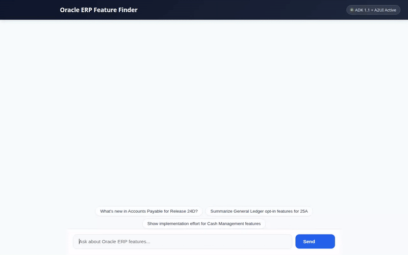

# Oracle Cloud Fusion ERP Feature Finder & Summarizer



A conversational AI assistant built with the **Agent Development Kit (ADK 1.1.0)** that helps enterprise finance leaders, admins, and consultants discover, evaluate, and summarize quarterly Oracle Cloud Fusion ERP Financials release updates (e.g., General Ledger, Accounts Payable, Accounts Receivable, Fixed Assets, Cash Management).

---

## 🚀 What It Does

- **Quarterly Feature Discovery**: Searches and filters quarterly release features (24A–24D, 25A–25D, 26A–26C) stored in Google Cloud Firestore by module, opt-in requirement, or keyword.
- **Visual Process Diagrams**: Generates process flow diagrams for new release features using Vertex AI Imagen (`imagen-3.0-generate-002`) and stores them in Google Cloud Storage for display.
- **Feature Highlight Videos**: Generates short animated feature video highlights using Vertex AI Omni (`gemini-omni-flash-preview` in the `global` region) and uploads them to Google Cloud Storage.
- **Implementation ROI & Effort Calculation**: Computes estimated labor hours saved, annual ROI, and implementation complexity using custom logic and the Agent Platform Python Sandbox Code Executor.
- **Live FX Currency Rates**: Fetches real-time foreign exchange conversion rates for multi-currency financial impact analysis.
- **Cross-Session Memory**: Remembers user preferences, role focus, and frequently searched ERP modules across sessions using Vertex AI Memory Bank.
- **Structured A2UI Cards**: Renders clean, interactive A2UI cards (Basic Catalog v0.8) for feature spotlights, process diagrams, and financial summaries.

---

## 🛠️ Google Cloud Services & Tools Wired Up

| Capability | Service / Tool | Implementation Details |
| :--- | :--- | :--- |
| **Agent Framework** | ADK 1.1.0 & Gemini 2.5 Flash | Core agent runtime, instruction orchestration, and callbacks |
| **Long-Term Memory** | Vertex AI Memory Bank | Cross-session facts and module preference retention (`PreloadMemoryTool` + callback) |
| **Database** | Google Cloud Firestore | Feature store with release updates (`search_erp_features`, `add_erp_feature`) |
| **Object Storage** | Google Cloud Storage | Public bucket storing generated diagram images and feature videos |
| **Image Generation** | Vertex AI Imagen (`imagen-3.0-generate-002`) | Diagram generation (`generate_erp_feature_diagram`) |
| **Video Generation** | Vertex AI Omni (`gemini-omni-flash-preview`) | Short feature highlight videos (`generate_erp_feature_video`) |
| **Code Execution** | Agent Engine Sandbox Code Executor | Isolated Python code sandbox for math and ROI model calculations |
| **UI Protocol** | A2UI (v0.8 Basic Catalog) | Structured JSON card layouts rendered in custom web chat frontend |
| **Live API Integrations** | Open ER Exchange Rates API | Real-time foreign exchange rate retrieval (`get_foreign_exchange_rates`) |

---

## 🔮 Planned / Future Capabilities

The following capabilities were explored in initial planning but are **planned, not yet implemented**:
- **BigQuery Audit Logging**: Automated streaming of feature evaluation logs to BigQuery for enterprise compliance reporting.
- **Cloud Trace Deep Monitoring**: End-to-end telemetry spanning multi-tool function chains.

---

## 💻 Local Setup & Running Instructions

### Prerequisites
- Python 3.11+ and `uv`
- `gcloud` CLI authenticated with active Google Cloud credentials (`gcloud auth login` and `gcloud auth application-default login`)

### 1. Install Dependencies
```bash
uv sync
```

### 2. Set Environment Variables
```bash
export AGENT_ENGINE_RESOURCE_NAME="projects/<PROJECT_NUMBER>/locations/us-east1/reasoningEngines/<ENGINE_ID>"
export AGENT_DIRECTORY="app"
```

### 3. Run the Agent Locally
```bash
uv run adk web app
```

### 4. Run the Web Chat Frontend Locally
From the `frontend/` directory:
```bash
cd frontend
pip install -r requirements.txt
python main.py
```
*(The local server will start on port 8080).*
